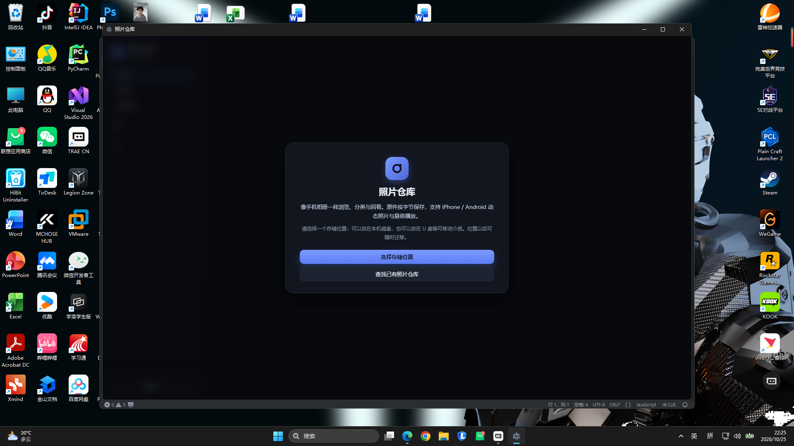

# 照片仓库 · 验收报告（阶段 6）

版本：1.0.0　验收日期：2026-10-25　环境：Windows 11（10.0.26200）x64

## 1. 验收范围

依据《需求基线》第 5 节：字节保真、实况关联、悬停播放、非破坏裁剪、存储迁移、断连降级、打包可用。覆盖库层自动化自测、开发版 UI 冒烟、打包版运行与缓存重建。

## 2. 测试样本

用脚本生成 7 个条目（均为可复现的合成样本）：

| 样本 | 用途 |
| --- | --- |
| `beach.jpg`（1600×1200） | 静态 JPEG；像素保真、全尺寸直接读原件、裁剪 |
| `tree.png`（900×1200） | 静态 PNG；裁剪/缩略图 |
| `IMG_1001.JPG` + `IMG_1001.MOV` | iPhone 同名配对实况（大写扩展名） |
| `motion_google.jpg` | XMP `MicroVideoOffset` 元素写法 + 尾部内嵌 MP4 |
| `motion_samsung.jpg` | JPEG 尾部直接追加 MP4（`ftyp` 启发式） |
| `clip.mp4` | H.264 独立视频 |
| `clip_hevc.mov` | HEVC 视频；验证兼容预览 |

## 3. 自动化自测结果

执行库层自动化自测（临时脚本生成样本并直接调用 Library 层），全部断言通过：

```
导入结果: { added: 7, skipped: 0, failed: [], live: 3, total: 8 }
H.265 兼容预览: proxy 153ef62c...-proxy.mp4
缩略图尺寸: 400 x 300
裁剪派生件: 800 x 600 (期望 800 x 600)
重建索引: { total: 7, added: 0, removed: 0 }
迁移: { ok: true, files: 10, root: '...\migrated-lib' }
✅ 库层自测全部通过
```

| 用例 | 结果 | 说明 |
| --- | --- | --- |
| 导入去重与计数 | 通过 | 8 个源文件 → 7 条目（配对视频不单独成条） |
| 实况识别 | 通过 | 3/3：paired / google / samsung |
| 导入字节保真 | 通过 | 5 个代表样本源/目标 SHA-256 一致 |
| 缩略图 | 通过 | 400×300（显示层） |
| JPEG 全尺寸 | 通过 | 直接使用原文件，未生成派生件 |
| HEVC 可播放化 | 通过 | 生成 `*-proxy.mp4`，原件未改写 |
| 非破坏裁剪 | 通过 | 另存为新裁剪图；原文件与索引均未改写 |
| 软删除 / 还原 | 通过 | 三路（图/视频/实况关联件）路径恢复 |
| 相册 / 标签 / 收藏 | 通过 | 创建、加入、更新、筛选正确 |
| 重建索引 | 通过 | 7 条全部保留，分类与裁剪不丢 |
| 库迁移 | 通过 | 10 个文件复制校验；libraryId、字节、实况保持 |

### 3.1 查看器与裁剪语义复测（第 3 轮）

针对「静图裁剪不得覆盖原图、查看器自动播放与自适应」三项改进，新增合成样本复测（静图 2000×1500、实况配对、独立视频 1280×720），自动化断言 25/25 通过：

| 用例 | 结果 | 说明 |
| --- | --- | --- |
| 静图裁剪另存新图 | 通过 | 生成 `big-裁剪.jpg`（1000×750，与原图同目录） |
| 原图零改写 | 通过 | 原图哈希与尺寸不变，索引中 `crop` 仍为 `null` |
| 重复裁剪不覆盖 | 通过 | 第二次生成 `big-裁剪-1.jpg`，不覆盖首个结果 |
| 视频不可裁剪 | 通过 | 仍返回「视频不支持裁剪」 |
| 静态图自适应 | 通过 | 2000×1500 缩放为 847×635 完全适配，无滚动、底栏可见 |
| 查看器自适应 | 通过 | 静态图 / 实况 / 视频均按可视区域等比缩放，无需滚动即可看全 |
| 实况自动播放 | 通过 | 进入查看器即播放，自适应显示 |
| 实况点击暂停/继续 | 通过 | 点击画面暂停，再次点击继续 |
| 视频自动播放 | 通过 | 进入即播放，1280×720 适配显示，控制条可见 |
| 视频点击暂停/继续 | 通过 | 点击画面暂停，再次点击继续 |
| 移除「播放实况」按钮 | 通过 | 查看器中已无 `#v-play` 按钮 |

## 4. UI 冒烟（开发版）

以测试库启动 Electron，通过自动截图检查：

- 网格渲染 7 个瓦片、时间线「今天」分组、侧栏相册/标签计数正确。
- 悬停实况瓦片后视频层出现并播放（H.264 循环），移出停止。
- 双击进入查看器：原图正确、计数 1/7、按可视区域自适应显示；实况进入即自动播放，点击画面可暂停/继续。
- 裁剪弹窗正确显示原图（非裁剪视图），8 个手柄、比例按钮、尺寸信息可用。

冒烟过程中修复：启动时若库打开晚于渲染进程初始化，界面会停留在引导页；现在打开库后会主动推送 `library-changed` 状态。

### 4.1 导入性能与交互复测

针对「导入慢、交互弱」的反馈，改为 4 路并发 + 系统级复制 + 目标文件单次哈希，并让网格实时并入新条目、进度条显示百分比与当前文件。复测结果：

```
summary { added: 9, skipped: 2, failed: [], live: 1, total: 11 }
实时条目事件: 9　耗时: 223 ms（9 张图片 + 2 个视频的合成样本）
✅ 并发导入自测通过
```

- 同内容文件在并发下只入库一次；同名文件通过预留队列避免覆盖。
- iPhone 配对实况在并发导入下仍正确识别（`motionStatus = ready`）。
- 进度回调包含新增条目，渲染层按 220 ms 合并刷新，无需等全部完成。

## 5. 打包验收

产物：

| 文件 | 大小 | 说明 |
| --- | --- | --- |
| `dist/PhotoRepository-Setup-1.0.0-x64.exe` | 约 99.6 MB | NSIS 安装版，可选安装目录 |
| `dist/PhotoRepository-Portable-1.0.0-x64.exe` | 约 99.4 MB | 便携版 |
| `dist/win-unpacked/` | — | 免安装目录 |

验证：

- 静默安装成功（退出码 0），安装目录为 `%LOCALAPPDATA%\Programs\PhotoRepository`；启动后进入首次运行引导页，可正常选择存储位置；静默卸载成功并清理安装目录。
- 打包目录应用启动成功，网格正常显示。
- 删除测试库的缩略图、封面、兼容预览缓存后，用打包版启动；缓存全部重新生成（3 个缩略图、2 个封面、1 个 HEVC 兼容预览、2 个实况播放版本），证明打包环境下 sharp 与 ffmpeg 路径解析正常（`app.asar.unpacked`）。
- 便携版启动成功并正常显示同一库。
- NSIS 安装包构建成功（未做代码签名）。

首次运行界面：



## 6. 已知问题与限制

| 类别 | 说明 |
| --- | --- |
| 签名与图标 | 未配置代码签名证书，SmartScreen 可能提示；未提供自定义应用图标，使用 Electron 默认图标 |
| HEIC 实测 | 解码使用内置 libheif WASM；未使用真实 iPhone HEIC 实况样本做端到端验证，仅有合成样本 |
| 实况识别 | 厂商实现差异大，Samsung 采用尾部 `ftyp` 启发式；识别失败会降级为静态并标记「待支持」 |
| RAW | 可入库保存，但界面不显示像素，标记「格式待支持」 |
| HEVC | 显示使用 H.264 兼容预览；预览为显示层有损，原件与导出不受影响 |
| 大库性能 | 采用虚拟滚动与按需加载；未在 1 万+ 真实照片库上做压力测试 |
| 实时监听 | 不监听文件系统；库外新增文件需通过导入或重建索引进入 |
| 多屏 / 高 DPI | 使用系统缩放与窗口尺寸记忆；未做专门的多显示器布局测试 |
| UI 自动化 | 目前为截图冒烟，未建立端到端 UI 自动化测试套件 |
| 构建环境 | 在无符号链接权限的 Windows 环境构建时，electron-builder 解压 `winCodeSign` 可能失败；已通过仅解压 Windows 部分到缓存解决，常规环境可忽略 |

## 7. 回退与恢复

- **迁移失败**：目标副本清理，原库保持原状；应用继续使用原库。
- **介质断连**：只读降级，不写入不崩溃；恢复后自动恢复写入。
- **索引/缓存损坏**：删除 `.photo-repo/cache` 或用「重建索引」恢复；原件不受影响。
- **裁剪误操作**：保存裁剪只在原图之外新增文件（新裁剪图或新裁剪实况），原件与原始动态视频从未被修改；如需撤销直接删除新增文件即可。
- **安装包回退**：便携版不写系统目录，可直接替换为上一版本可执行文件；库数据独立于应用安装位置。

## 8. 结论

阶段 0–6 的既定验收项均通过；已知限制不影响核心链路（导入保真、实况悬停、非破坏裁剪、存储迁移、断连降级）。可以交付试用。
